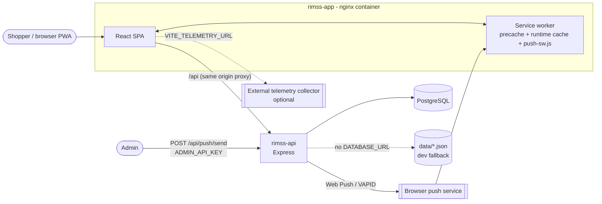
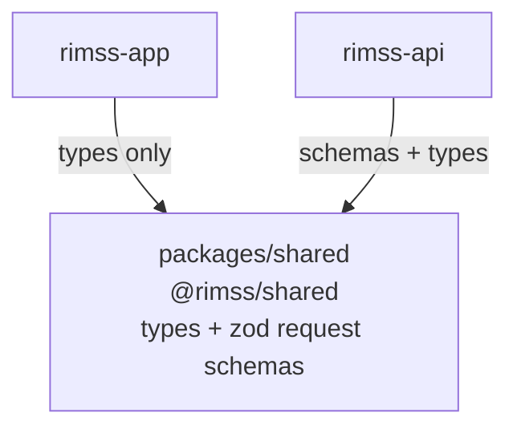
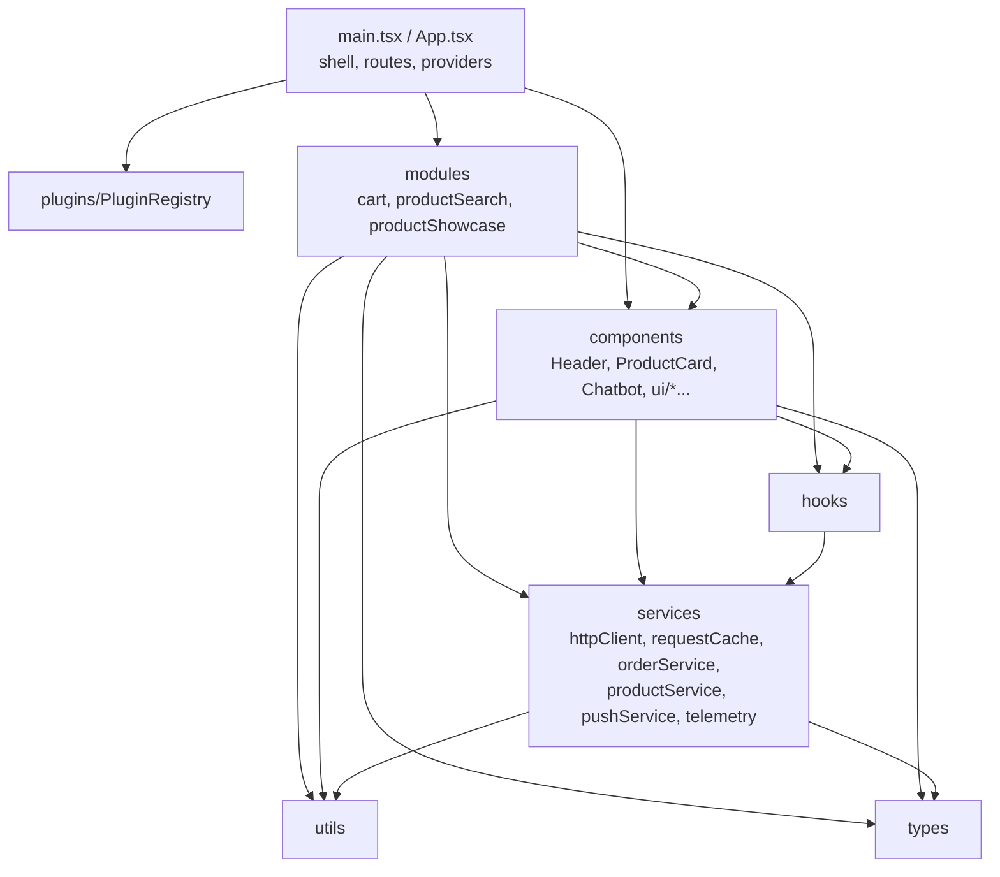
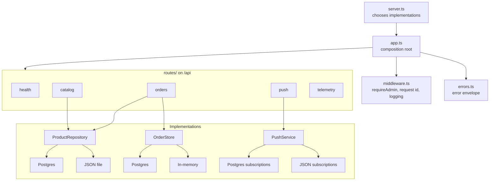
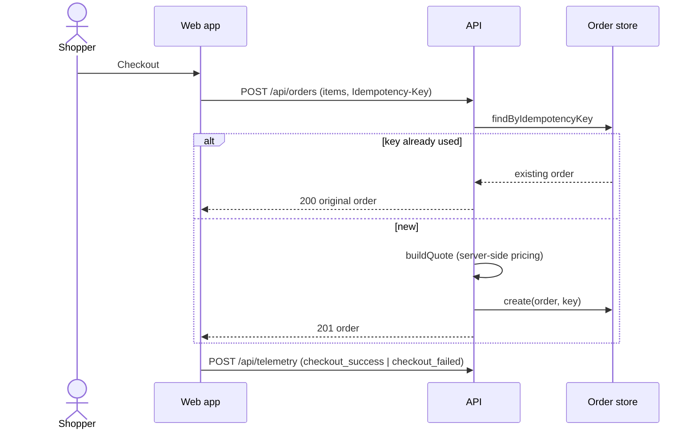
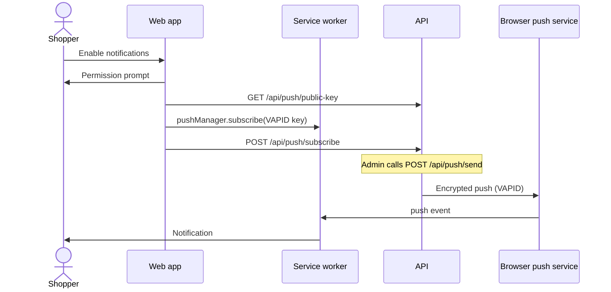
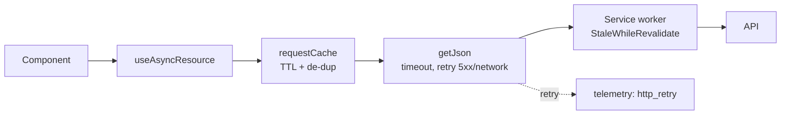
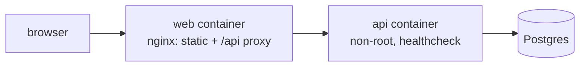

# RIMSS architecture

Decisions behind these views are recorded in [docs/adr](adr).

## 1. System context



## 2. Repository and package dependencies



## 3. Web app layers (ADR 0001)



Modules register themselves with `PluginRegistry`; `App` renders one route per registered plugin, each wrapped in `ModuleErrorBoundary`. Only `cart` may be imported by other modules.

## 4. API structure (ADR 0002)



## 5. Checkout with idempotency (ADR 0004)



## 6. Push subscription (ADR 0006)



## 7. Resilient reads and caching (ADR 0005, 0007)



## 8. Deployment



## 9. Folder structure

### Repository

```text
RIMSS/
├─ package.json, turbo.json            npm workspaces + Turborepo (ADR 0009)
├─ eslint.config.mjs, commitlint.config.mjs
├─ docker-compose.yml                  web + api + Postgres
├─ docs/                               this file and adr/
├─ packages/shared/src/index.ts        @rimss/shared contract
├─ rimss-api/                          Express API
├─ rimss-app/                          React PWA
├─ deliverables/gen/                   document generators (not in runtime build)
└─ Req_Doc/                            requirements
```

### rimss-app

```text
rimss-app/
├─ index.html, vite.config.ts          Vite + PWA plugin config
├─ nginx.conf, Dockerfile              production image
├─ playwright.config.ts, e2e/          e2e, accessibility, resilience specs
├─ public/
│  ├─ _headers                         CSP and security headers
│  └─ push-sw.js                       push + notificationclick handlers
├─ scripts/                            check-bundle-size, PWA icon generation
└─ src/
   ├─ main.tsx, App.tsx, App.scss      entry and shell (routes from registry)
   ├─ plugins/PluginRegistry.ts        module manifest + feature flags
   ├─ modules/                         feature modules (barrel per module)
   │  ├─ index.ts                      registers all modules
   │  ├─ cart/                         CartContext, CartDrawer, cartLogic, cartStorage
   │  ├─ productSearch/                ProductSearchModule, filterProducts, searchParams
   │  └─ productShowcase/              ProductShowcaseModule
   ├─ components/                      shared UI
   │  ├─ Chatbot/                      rule-based chat + responses.json
   │  ├─ Header/, ProductCard/, NotificationToggle/, UpdatePrompt/
   │  ├─ Loader/, Skeleton/, ErrorFallback/, ModuleErrorBoundary/
   │  └─ ui/                           Button, Card, Field, Heading, Table
   ├─ hooks/                           useAsyncResource, useDebouncedValue
   ├─ services/                        httpClient, requestCache, productService,
   │                                   orderService, pushService, telemetry
   ├─ utils/                           price
   ├─ types/                           cart, order, product
   ├─ styles/, assets/                 global styles and static assets
   └─ test/, setupTests.ts             fixtures and Vitest setup
```

### rimss-api

```text
rimss-api/
├─ Dockerfile, tsconfig*.json
├─ data/                               dev JSON stores (products, subscriptions, telemetry, vapid)
├─ migrations/                         001_init.sql, 002_order_idempotency.sql
├─ src/
│  ├─ server.ts                        picks Postgres or file/memory implementations
│  ├─ app.ts                           composition root
│  ├─ config.ts, logger.ts, errors.ts, middleware.ts
│  ├─ db.ts                            pool helpers, migrations, Postgres stores
│  ├─ products.ts, orders.ts, push.ts  interfaces + file/memory implementations
│  └─ routes/                          health, catalog, orders, push, telemetry
└─ test/                               api, config, logger, postgres, push, telemetry
```

### packages/shared

```text
packages/shared/src/index.ts           types and zod request schemas (ADR 0003)
```
